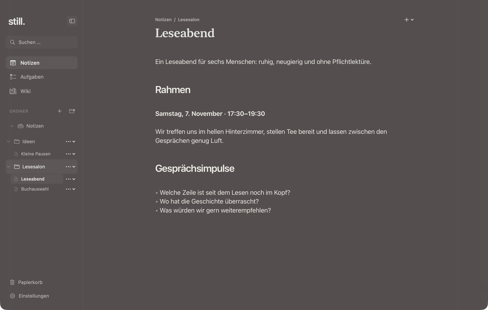
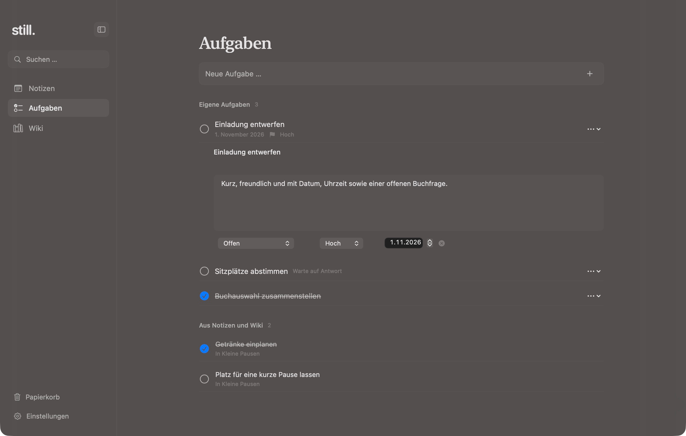
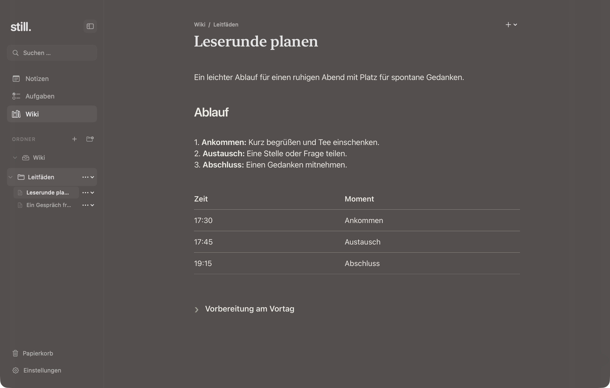

# still.

`still` is a small local-first macOS notes app for Markdown notes, checklists, standalone tasks, and a personal wiki. Notes and attachments stay on this Mac under `~/Library/Application Support/still`. The `STILL_DATA_DIR` environment variable can point the app at a separate workspace.

## Screenshots

These screenshots use fictional demo content about a small reading salon.

**Notes** — Planning a small reading evening.



**Tasks** — A short set of reading-evening preparations.



**Wiki** — A compact guide for planning a reading group.



## Build

Requires macOS 27 or later and Xcode 27 with Swift 6.4. The normal app build works offline and needs no Node.js, npm, Homebrew, or access to GitHub.

```sh
./Scripts/build.sh
```

The script creates `build/still.app` and prints the app path when packaging finishes. All Swift dependencies, including their transitive dependencies, are included as local source packages in `Vendor/`. Keep that directory when copying or archiving the project; an existing `.build/` directory or package cache is not required. Versions, upstream revisions, licenses, and maintenance instructions are documented in [`Vendor/README.md`](Vendor/README.md).

The editor is already bundled in the repository. The build validates its contents against the editor sources, independently of file timestamps, and never installs npm packages. If the bundle is missing or out of date, the build stops with instructions to rebuild it explicitly.

To build and run the Swift tests directly, use `swift test`.

### Editor development

Only changes to the JavaScript editor require Node.js/npm. On a development machine with access to the npm registry, regenerate and commit the editor bundle and its content fingerprint together with the sources:

```sh
cd Editor
npm ci
npm run build
```

Afterward, the normal app build works offline again. Optional AI and Confluence connections still need access to their configured endpoints when used.

## Optional AI

AI is off by default. Add an HTTPS OpenAI-compatible endpoint (or a local HTTP endpoint), model name, and optional API key in Settings. The key is stored in macOS Keychain; the app’s workspace manifest does not contain it. When enabled, Wiki and Optimize send the selected text and a bounded context from notes, wiki pages, and their folder names to the configured provider. Turning AI off disables those requests.

Markdown is stored as plain `.md` files. Images imported through the editor are saved in the workspace’s `attachments` folder.

## Finding notes and tasks

Press ⌘K to open the quick switcher. With no query it shows favorites and recently opened notes; typing searches visible notes, Wiki pages, and tasks. Title matches appear first, and matching text excerpts help identify content results. Use the arrow keys and Return to open a result, or Escape to close the switcher. Stars in the sidebar and switcher add or remove favorites. Favorites and the twelve most recently opened notes are saved locally across restarts.

Press ⌘F to find text inside the open note. The find bar shows the current match and total count, supports previous/next navigation, and closes with Escape. Opening a content result from global search or the switcher reveals a matching passage. Press ⌥⌘F to focus global search, or ⌘N to create a new note in the current notes/Wiki folder. From Tasks or Chat, ⌘N creates a regular note. In the editor, ⇧⌘K inserts a Markdown link; ⌘K always opens the quick switcher.

## Focused tasks

The task board has All, Today, Upcoming, and Waiting views. Today includes open tasks due today or overdue; Upcoming includes open tasks due on a later calendar day. Waiting tasks have their own view. Undated tasks and note checklists remain available under All. Completed tasks and checklist items start in a collapsed section and can be reopened. Overdue dates have a quiet visual indicator.

## Reviewing AI edits

Optimize opens a review sheet before sending a request. Choose the current note, its folder, specific visible notes/Wiki pages, or no additional context. The sheet then shows the original selection and proposed replacement side by side. Accept applies the replacement as one undoable edit; Discard leaves the source unchanged and cancels pending generation. A proposal is rejected if its source or relevant settings have changed.

## Links between notes

Type `[[Page title]]` to link a note or Wiki page; `[[Page title|label]]` displays a custom label. The editor offers matching notes while you type. Use a full target such as `[[wiki/Guides/Getting started]]` when titles are ambiguous. Press ⌘-click or ⌘↩ on a link to open it; a missing target can be created in the current section and folder. Links to external HTTP(S) and email addresses open in the default app. The editor shows backlinks below the note, and ⌘[ returns to the previous note. Link targets are updated when a linked note or folder is renamed or moved.

## License

Copyright (C) 2026 Luke Schröter. `still` is licensed under the GNU General Public License, version 3 or (at your option) any later version; see [`LICENSE`](LICENSE). Third-party dependencies remain under their respective licenses; see the bundled [third-party notices](Sources/Still/Resources/Editor/THIRD_PARTY_NOTICES.txt).

## Chat and knowledge sources

Chat keeps multiple named conversations locally in `conversations.json` in the same workspace as notes. Streaming replies are saved periodically and flushed when the app becomes inactive or exits. Interrupted replies remain readable and can be retried without duplicating the question. Switching conversations keeps the request running; deleting its conversation, changing settings, or disabling AI cancels it. Chat history remains readable while AI is off.

Chat uses the selected OpenAI-compatible model and endpoint. It can search and read currently visible local notes and Wiki pages. Disabling Wiki keeps its files but excludes them from navigation and new AI context. Conversation history may still contain previously generated answers and source titles. Read source contents are untrusted reference data; tool payloads and credentials are never stored in conversations. Requests use up to six tool rounds, 18,000 characters of knowledge per turn, and 60,000 characters of recent conversation history, preserving whole turns. Questions are limited to 30,000 characters.

The Chat composer lets you limit new local knowledge to all visible notes, the last opened note, its folder, or none. Confluence is a separate opt-in source for each request. These choices restrict both search and document reads. Changing the source selection does not remove content already present in the conversation history.

Confluence is optional. Configure an HTTPS Confluence Data Center base URL (including its context path, for example `https://wiki.example.org/confluence`) and a Personal Access Token in Settings. Loopback HTTP is supported for development. Tokens are stored in Keychain separately for each normalized instance. Disabling Confluence keeps its token; the explicit remove action deletes it. Connection testing verifies an authenticated current user. Only read-only search and current-page retrieval are available, with a maximum of ten search results. Redirects are refused so credentials cannot leave the configured instance.

Confluence tools use the official MCP Swift SDK 0.12.1 with an in-process MCP server/client pair, initialization, tool discovery, and tool calls over `InMemoryTransport`. No external MCP service, Node.js, or Python is required at runtime. SwiftSoup 2.14.3 turns page HTML into bounded readable text. Textual 0.5.0 renders chat Markdown. Their licenses are included in [additional third-party notices](Sources/Still/Resources/THIRD_PARTY_NOTICES.txt).

If the provider explicitly rejects streaming, Chat retries once without streaming. If it explicitly rejects tools, Chat continues as ordinary chat with a visible notice. It never selects another model automatically. Network failures or partial replies are not retried automatically.
