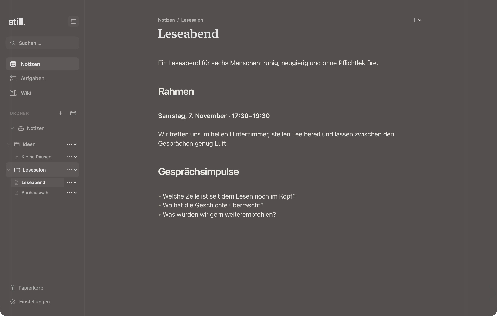
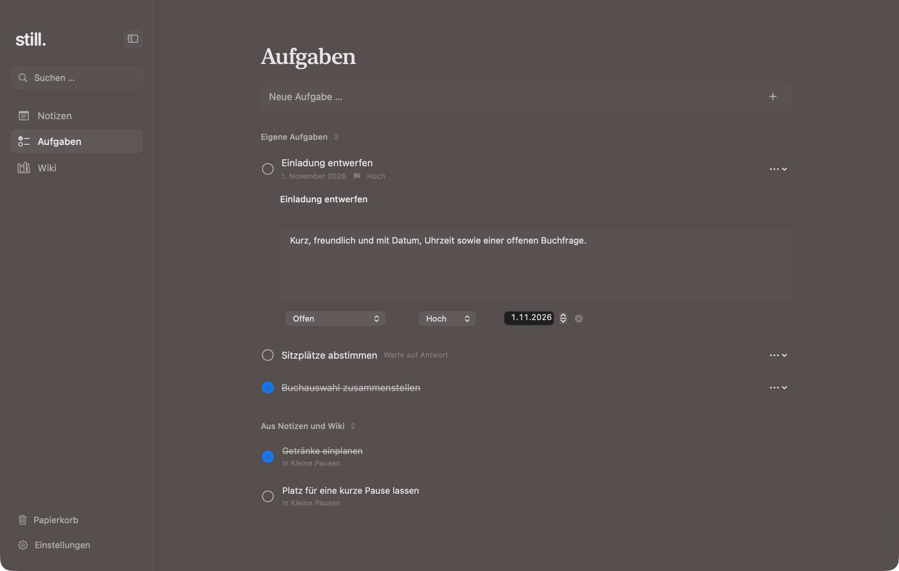
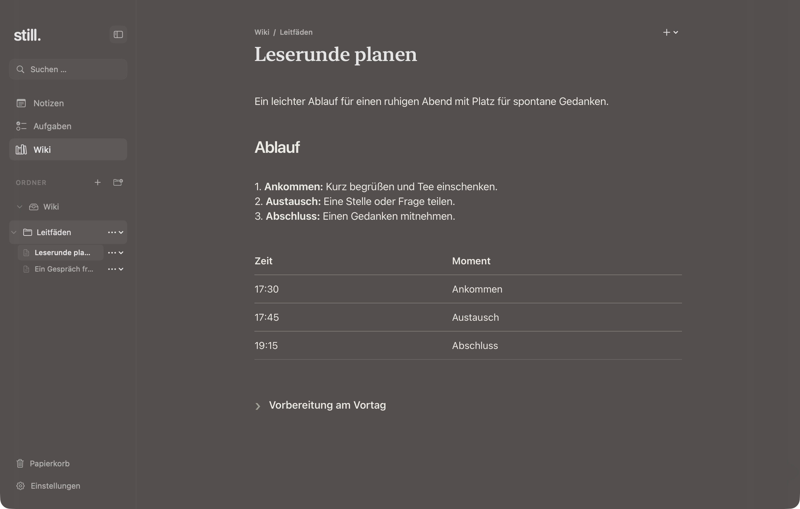

# still.

`still` is a small local-first macOS notes app for Markdown notes, checklists, standalone tasks, and a personal wiki. Notes and attachments stay on this Mac under `~/Library/Application Support/still`. The `STILL_DATA_DIR` environment variable can point the app at a separate workspace.

## Screenshots

These screenshots use fictional demo content about a small reading salon.

**Notes** — Planning a small reading evening.



**Tasks** — A short set of reading-evening preparations.



**Wiki** — A compact guide for planning a reading group.



## Build

Requires macOS 27 or later, Xcode 27 with Swift 6.4, and Node.js/npm only when the bundled editor needs rebuilding.

```sh
./Scripts/build.sh
```

The script creates `build/still.app`. It reuses the bundled editor when its source files are unchanged and prints the app path when packaging finishes. To build and run the Swift tests directly, use `swift test`.

## Optional AI

AI is off by default. Add an HTTPS OpenAI-compatible endpoint (or a local HTTP endpoint), model name, and optional API key in Settings. The key is stored in macOS Keychain; the app’s workspace manifest does not contain it. When enabled, Wiki and Optimize send the selected text and a bounded context from notes, wiki pages, and their folder names to the configured provider. Turning AI off disables those requests.

Markdown is stored as plain `.md` files. Images imported through the editor are saved in the workspace’s `attachments` folder.

## License

Copyright (C) 2026 Luke Schröter. `still` is licensed under the GNU General Public License, version 3 or (at your option) any later version; see [`LICENSE`](LICENSE). Third-party dependencies remain under their respective licenses; see the bundled [third-party notices](Sources/Still/Resources/Editor/THIRD_PARTY_NOTICES.txt).
